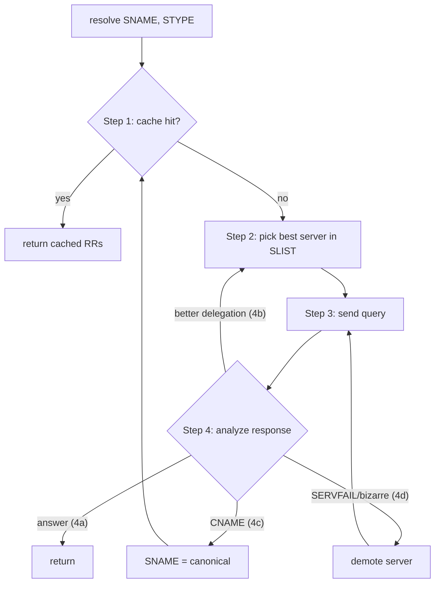
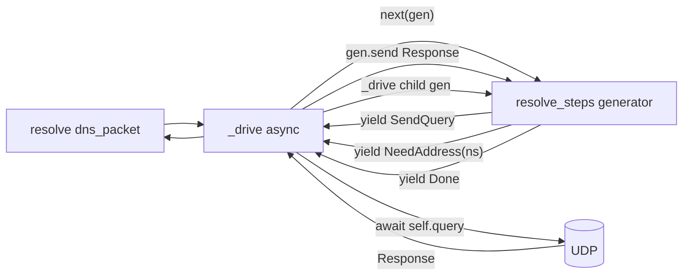

# Recursive Resolution: RFC 1034 mapped onto Namespy

This document is the contributor reference for changes to
[`namespy/resolver.py`](../namespy/resolver.py). It summarizes the parts of
[RFC 1034](https://www.ietf.org/rfc/rfc1034.txt) that drive resolution
decisions and points at the symbols in our code that implement each.

## 1. Recursive vs iterative service (RFC 1034 §4.3.1)

DNS messages carry two flag bits relevant to recursion:

- **RD** (Recursion Desired) — set by the *client* when it wants the
  server to chase referrals on its behalf.
- **RA** (Recursion Available) — set by the *server* when it is willing
  to provide that service.

`RecursiveResolver` accepts client queries with `RD=1` and answers
them by performing iterative resolution **upstream**: it sends its own
queries with `RD=0` to authoritative servers and follows referrals
itself. The `SendQuery` effect builds queries via
`Resolver.query(..., RD=False)`.

## 2. Resolver state (RFC 1034 §5.3.2)

| Spec field | Meaning | Namespy symbol |
|---|---|---|
| SNAME  | The name we're searching for | `Sname.qname` |
| STYPE  | QTYPE of the search | `Sname.qtype` |
| SCLASS | QCLASS | `Sname.qclass` |
| SLIST  | Best-known nameservers for the current zone-cut | `Slist` |
| SBELT  | Safety-belt servers from configuration | `Sbelt` (built from `named.root` in `RecursiveResolver.bootstrap`) |
| CACHE  | RRs from previous responses | `DnsCache` (`MemoryDnsCache`, `SqliteDnsCache`), consulted at step 1 and written by `cache.put` |

Each `SlistEntry` is a `(zone, ns, addresses, history)` row representing
one nameserver candidate.

## 3. The four-step algorithm (§5.3.3)

In Namespy:

- **Step 1** (cache lookup): consulted at the top of every iteration of
  `resolve_steps`, so a re-anchored alias target gets a cache check too rather
  than only the original QNAME. A hit yields `Answer`/`Nxdomain`/`Nodata` plus
  `Done(_synthesize_response(...))` and returns without touching the network;
  a miss falls through to step 2. Writes happen through `cache.put` when a
  response is classified. See
  [`namespy/cache/__init__.py`](../namespy/cache/__init__.py) for `DnsCache`, its
  in-memory and SQLite backends, and how negative entries take their TTL from
  the SOA (RFC 2308 §5).
  Ahead of any query, and just behind that lookup, sits the other cache,
  `FailureCache` (RFC 9520 §3.2): if this name, or a zone it lies beneath, failed
  recently, the lookup ends there with `Fail` and no query leaves the process. The
  order is deliberate — a stored answer beats a remembered failure, because having
  once resolved a name is better evidence than having once failed to, and it is
  what lets a cached CNAME restart the loop instead of being masked by a dead zone
  it happens to sit under. It is a separate store because a failure is not an
  answer: `DnsCache.get(name, qtype, qclass)` cannot express "every name under
  `dead.example`". Recording happens at the two places a lookup dies — servers
  exhausted (a zone failure, keyed on `slist.zone`, so §3.3's next name under that
  zone is stopped too) and name-specific death (alias loop, hop budget, no servers
  to ask) — and a successful lookup clears what was remembered about the name and
  about every zone that spoke during it.
- **Step 2** (pick best server): `Slist.best()` returns the first
  non-demoted entry. If that entry has no addresses, the generator
  yields `NeedAddress(ns)` and the driver runs a *nested* `resolve_steps`
  to discover them (see §7).
- **Step 3** (send): the generator yields `SendQuery(entry, questions)`;
  the async driver fulfills it with `Resolver.query(...)` and feeds the
  response back via `gen.send(response)`.
- **Step 4** (analyze): `classify(response, sname, slist, entry)` is a
  small pure generator that yields one of:
  - `Answer(records)` + `Done(response)` — final answer (4a),
  - `Referral(old_zone, new_zone, match_before, match_after)` — valid
    "closer" delegation (4b), after extending `Slist`,
  - `Cname(target)` — one redirection taken; if no `Done` follows, the driver
    re-anchors SNAME and restarts at step 2 (4c, see §6),
  - `Demote(entry, reason)` — SERVFAIL / bogus / not-closer (4d),
  - `Fail(reason)` — a broken alias chain or exhausted hops, which is
    deliberately *not* a cacheable negative.

## 4. Match count and "closer" delegations (§5.3.3 step 4b)

A referral is only progress if the new zone has *strictly more* labels
in common with SNAME (counted from the root) than the previous zone:

- SNAME = `example.org`, current zone = `.` (match 0).
- Referral to `org.` (match 1) — accepted.
- Referral to `example.org.` (match 2) — accepted.
- Referral back to `.` or to `com.` (match 0) — rejected, server demoted.

`Sname.match_count(zone)` does the counting; `classify()` enforces the
inequality before extending `Slist`.

## 5. Negative responses (§4.3.4)

NXDOMAIN and NODATA both carry the SOA in the **authority** section of
the wire response, *not* the answer section. Our classifier mirrors
that:

- `RCODE == NAME_ERROR` → NXDOMAIN. Yields `Nxdomain()` then `Done(response)`.
- Any other non-`NO_ERROR` RCODE → `Demote(entry, "rcode <mnemonic>")`, and
  the lookup tries another server. The mnemonic comes from
  `DnsResponseCode.mnemonic()` because RCODE is a plain `int` for values the
  enum has no member for (11-15 are unassigned; §6.1.3 of RFC 6891 makes the
  field 12 bits wide).
- `ANCOUNT == 0` → the **content of the authority section** decides, per
  RFC 2308 §2.2.1, which classifies by SOA-versus-NS presence rather than by
  the `AA` bit:
  - `AA=1`: a server claiming authority cannot simultaneously be referring us
    onward, so an empty answer is NODATA whatever else is there.
  - `AA=0` with SOA and no NS: "type 2" NODATA — a shape RFC 2308 §2.2.1
    recommends precisely because the alternative is so often misread as a
    referral.
  - `AA=0` with NS RRs *closer* than the current zone: a referral (§5.3.3 4b).
  - `AA=0` with neither: `Demote`, because a negative answer with no SOA has no
    TTL and RFC 2308 §5 says it "SHOULD NOT be cached as there is no way to
    prevent the negative responses looping forever".

The SOA (if present) is read straight out of `response.nameservers`; it is
never re-queried. Do **not** synthesize an extra SOA query — the SOA is already
in the response we just received, and a second query would race against it.

Classifying on `AA` *before* inspecting the authority section was an earlier
bug: the non-authoritative NODATA above is the common case for a recursive
resolver, and it was being sent down the referral path, which demoted a
perfectly healthy server.

## 6. Alias chasing (§5.3.3 step 4c, RFC 6672)

An answer that contains a CNAME whose target is not itself answered is **not
a conclusion**: §5.3.3 step 4c says "if the answer contains a CNAME RR, set
SNAME to the contents of the RDATA field of the displayed CNAME RR, and go to
step 2". So the lookup restarts with QNAME re-anchored at the target, QTYPE
unchanged — an A query for an aliased name becomes an A query for the target,
and only the target's RRset can end it.

Two pieces, deliberately split:

- `_follow_aliases(response, sname)` walks the chain *inside one response* and
  returns an `AliasWalk`: resolved records, the trace `Cname` events, either a
  `continued_at` target that needs another query, or a `failure`.
- `resolve_steps` owns the loop *across responses*, because only it can count
  hops over several round trips. It re-anchors `sname` and re-enters at step 2,
  bounded by `max_alias_hops` (`MAX_ALIAS_HOPS` by default, configurable per
  `Resolver`).

A trailing `Cname` with no `Done` is therefore the normal signal for "keep
going", not an error — `classify` stays a pure per-response classifier so it
remains directly testable, and the driver owns the state.

A chain that loops or exceeds the hop cap yields `Fail`, **not** NODATA:
RFC 2308 §5 would have us cache a NODATA against the zone SOA, so one malformed
alias set would hide a live name for the length of the zone's MINIMUM.

DNAME (RFC 6672) is handled in the same walk: a DNAME at or above QNAME
redirects the whole subtree, and the substitution replaces the suffix labels of
QNAME that match the owner with the labels in the DNAME's RDATA (§2.2). The
owner itself is never redirected — §2.3 says "the owner name of a DNAME is not
redirected itself" — so the enclosing-owner scan uses the strict subdomain test
(`is_subdomain_of(owner, include_self=False)`).

## 7. Glueless delegation (§5.3.3 step 2 priorities)

A referral can list NS names without addresses (no glue in the
additional section). We then need the address before we can query the
delegated zone. The generator yields `NeedAddress(ns_name)`; the driver
runs a nested `resolve_steps` for `ns_name A` (capped at `MAX_DEPTH`)
and feeds the resulting addresses back via `gen.send(addresses)`. The
nested resolution gets its own `Trace` child and renders as a separate
Mermaid `sequenceDiagram` block under the parent.

## 8. Server-side reply shape (§4.3.2 a/b/c)

Knowing what an authoritative server emits helps interpret what we
receive on the client side:

- **a**: matched node — copy matching RRs into answer; CNAME causes
  rename. `AA=1`.
- **b**: encountered an NS cut — copy NS RRs into authority, addresses
  into additional ("glue if needed"). `AA=0` (referral).
- **c**: no match — return NXDOMAIN (authoritative name error).

Mapping to our classifier:

| Server emits | Classifier branch |
|---|---|
| `AA=1`, `ANCOUNT > 0` | answer (4a, a) — after any CNAME/DNAME walk |
| Alias whose target is unanswered | re-anchor SNAME, go to step 2 (4c) |
| `AA=0`, `ANCOUNT = 0`, NS closer than current zone | referral (4b, b) |
| `ANCOUNT = 0`, SOA in authority | NODATA (§4.3.4; RFC 2308 §2.2.1) |
| `RCODE = NAME_ERROR` | NXDOMAIN (4d, c) |
| other `RCODE`, or no SOA to time a negative by | demote (4d) |

## 9. Architecture: generator of effects

The resolver becomes pure logic that yields effect objects describing
what to do next; the async driver fulfills them. The yield stream **is**
the trace (plus nested child streams for sub-resolves). Tests drive the
generator synchronously with `gen.send(canned_response)` — no sockets.

## 10. Code mapping

| Concept | File / symbol |
|---|---|
| SBELT root hints | `RecursiveResolver.bootstrap()` -> `RecursiveResolver.sbelt` |
| SLIST construction | `Sbelt.copy_for(sname)` |
| Server selection (§5.3.3 step 2) | `Slist.best()` |
| Send (§5.3.3 step 3) | `SendQuery` effect, `Resolver.query()` |
| Analyze (§5.3.3 step 4) | `classify(response, sname, slist, entry)` |
| Match count (§5.3.3 step 4b) | `Sname.match_count(zone)` |
| Glueless NS resolution | `NeedAddress` effect + `_drive` recursion |
| Negative responses (§4.3.4) | `Nodata`, `Nxdomain` events |
| Cached resolution failures (RFC 9520 §3.2, §3.3) | `FailureCache` + `FailureEntry` (`namespy/cache/__init__.py`), consulted and recorded in `resolve_steps`, owned by `RecursiveResolver.failure_cache` |
| Truncation → TCP retry (RFC 1123 §6.1.3.2) | `Resolver._await_udp()` → `Resolver._query_tcp()` |
| No-cache-on-truncation (RFC 1035 §7.4) | `_write_cache()` early return |
| EDNS(0) option TLVs, and the payload size each server gets told (RFC 6891 §6.1.2, §6.2.3, §6.2.4) | `EdnsOption` / `parse_options()` / `serialize_options()` (`namespy/edns.py`), `Resolver._advertised_payload()` |
| Extended DNS Errors, composed and consumed (RFC 8914) | `ExtendedDNSError`, `extended_dns_error_option()`, `extended_errors_of()` (`namespy/edns.py`); emitted by `DnsServer._error()`, read into the failure-cache reasons and the CLI's `; EDE:` lines |
| MQTYPE, answering (RFC 10029 §3.3–§3.4) | `namespy/mqtype.py`, `DnsServer._mqtype_request()` and `DnsServer._combine_mqtype()` |
| MQTYPE, asking (RFC 10029 §3.2, §3.5) | `namespy/bundle.py` (`query_option_for()`, `collect_bundle()`), `RecursiveResolver.resolve_bundle()` |
| SVCB / HTTPS service parameters (RFC 9460) | `SvcParams` (`namespy/svcb.py`), registered as the RDATA codec in `namespy/rdata.py` |
| The NXDOMAIN cut (RFC 8020 §2) | `NxdomainPolicy`, `NxdomainCut`, `_nxdomain_cut()` (`namespy/resolver.py`); the QTYPE-free `DnsCache.nxdomain_at()` in both backends (`namespy/cache/__init__.py`, `namespy/cache/sqlite.py`); rendered by `Trace.to_mermaid()` and the CLI's `;; NXDOMAIN cut:` line, switched by `--no-nxdomain-cut` |
| DNSKEY and DS without cryptography (RFC 4034 §2, §5, App. B) | `key_tag()`, `ds_digest()`, `DigestType`, `canonical_owner_octets()`, `key_material()`/`digest_material()` (`namespy/dnssec.py`); `RData_DNSKEY` and `RData_DS` registered as RDATA codecs in `namespy/rdata.py` |
| Denial-of-existence records: RRSIG, NSEC, NSEC3, NSEC3PARAM (RFC 4034 §3–§4, RFC 5155 §3–§4, §10.3) | `encode_type_bitmap()`, `decode_type_bitmap()`, `nsec3_hash()`, `encode_base32hex()`/`decode_base32hex()`, `iterations_within_limit()`, `NSEC3_OPT_OUT_FLAG`, `Nsec3HashAlgorithm` (`namespy/dnssec.py`); `RData_RRSIG` with `within_validity()`, `RData_NSEC`, `RData_NSEC3` with `hash_owner()`/`opt_out`, `RData_NSEC3PARAM` (`namespy/rdata.py`) |
| Canonicalisation and the signed octet string (RFC 4034 §6.2-§6.3, §3.1.3, §3.1.8.1; RFC 3597 §7) | `canonical_rdata_octets()`, `canonical_rr_bytes()`, `canonical_rrset_bytes()`, `canonical_rrset_rdatas()`, `rrsig_signed_data()`, `signed_owner_name()`, `rrsig_label_count()`, `CANONICAL_DOWNCASE_TYPES`, `CanonicalizationError`, `DuplicateRecordError` (`namespy/dnssec.py`); `canonical_wire()` on `RData` and its name-bearing codecs, `signed_data_prefix()` on `RData_RRSIG` |
| RSA key material and signature width (RFC 3110 §2-§3, RFC 5702 §2, erratum 2811) | `pack_rsa_public_key()`, `unpack_rsa_public_key()`, `rsa_signature_octets()`, `RsaPublicKey`, `MalformedRsaKeyError` (`namespy/dnssec.py`); `RData_DNSKEY.rsa_public_key()`, `.require_rsa_key()`, `.key_algorithm_is_rsa` (`namespy/rdata.py`); `RSA_ALGORITHMS`, `RSA_MIN_KEY_BITS_BY_ALGORITHM`, `minimum_rsa_key_bits()` (`namespy/crypto.py`) |
| The NSEC / NSEC3 denial-of-existence proof rules (RFC 4034 §6.1, RFC 4035 §5.4, RFC 4592 §3.3.1, RFC 5155 §6-§9) | `name_order_key()`, `canonical_name_before()`, `sort_canonical()`, `name_between()`, `hash_between()`, `nsec_matches()`, `nsec_proves_nxdomain()`, `nsec_proves_no_type()`, `nsec_proves_no_wildcard()`, `nsec_owner_is_explicit()`, `nsec3_owner_digest()`, `nsec3_matches()`, `nsec3_covers()`, `nsec3_proves_nothing()`, `nsec3_proves_no_type()`, `usable_nsec3()`, `nsec3_record_is_from_proper_zone()`, `closest_encloser_proof()`, `nsec3_proves_nxdomain()`, `wildcard_at()`, `ClosestEncloserProof`, `Nsec3NxdomainProof`, `IncompleteProofError`, `ContradictoryProofError` (`namespy/nsec.py`) |
| Cached denial proofs (RFC 8020 §2¶5, RFC 4035 §3.1.1¶3) | `NegativeEntry(..., proofs=...)` and `NegativeEntry.proofs` (`namespy/cache/__init__.py`); `SqliteDnsCache._add_proofs_column`, `_unpack_proofs` (`namespy/cache/sqlite.py`); `collect_proof_records()`, `proof_entries()`, `PROOF_TYPES` (`namespy/nsec.py`) |
| The optional cryptographic backend, and the algorithm policy it has to satisfy (RFC 9904 Table 2, RFC 3110 §2, RFC 5702, RFC 6605, RFC 8080) | `namespy/crypto.py` — `backend()`, `crypto_available()`, `require_backend()`, `MissingCryptoError`, `IMPLEMENT_FOR_VALIDATION`, `SIGNATURE_ALGORITHMS`, `MAX_RSA_KEY_BITS`; pulled in by the `crypto` extra and by nothing else (`tests/test_crypto_backend.py`) |
| QNAME minimisation probe schedule (RFC 9156 §2.3, §3) | `namespy/minimis.py`, driven from `resolve_steps` where it builds each probe's name |
| Trace tree | [`namespy/trace.py`](../namespy/trace.py) `Trace` |
| Mermaid output | `Trace.to_mermaid()` |

## 11. Known gaps

Deliberately unimplemented, each with the spec that would drive it:

- **EDNS(0) is sent as well as decoded, but only some of its options are used.**
  Outbound queries advertise an OPT record — 1232 octets, `--no-edns` or the
  constructor knob to stop — a received OPT yields `extended_rcode`, `ad`, `cd`
  and `requestor_payload_size` (RFC 6891 §6.1.3), and a FORMERR or BADVERS answer
  that arrives without an OPT alongside it earns the §6.2.2 unextended re-ask. Of
  the registered options, NSID (RFC 5001), Extended DNS Errors (RFC 8914) and
  MQTYPE (RFC 10029) are used in both directions; COOKIE (RFC 7873) and Padding
  (RFC 7830) decode and encode but are deliberately not put on the wire — there is
  no server-side cookie state to validate a reply against, and §6 of RFC 7830
  withdraws Padding from plaintext UDP, which is every transport here. Truncation
  is a direct consequence of whatever ceiling the path allows, and is handled: a
  `TC` answer is re-asked over TCP rather than believed (RFC 1123 §6.1.3.2).
- **QNAME minimisation** (RFC 9156) is available but not the default: pass
  `qname_min=True` (or `--qname-min`) to send each server only the labels the
  previous referral proved relevant. By default the full QNAME goes to every
  server on the way down. See the note in `resolve_steps`.
- **No DNSSEC validation.** The `AD` bit is surfaced but not verified; nothing
  in `RDATA` speaks RRSIG/DNSKEY (RFC 4033/4034/4035), and there is no trust
  anchor.
- **Bailiwick covers glue, and that is all a referral can carry.** `classify`
  refuses an *in*-bailiwick NS that arrives without glue, because RFC 1034 §4.2.1
  says a parent must supply it, and it discards glue for any name outside both the
  answering zone and the zone being delegated (RFC 5452 §6). What it does not do
  is cache anything else from a referral's extra sections — it stores no
  non-authoritative section at all, so the usual out-of-bailiwick poisoning path
  is closed by never being opened.
- **No IDN/punycode.** Labels are octets, end to end (RFC 2181 §11). A caller
  wanting RFC 5890-style A-labels must encode before calling.

Closed since this document was first written, and now covered by tests:
the cache (step 1), CNAME/DNAME chasing (step 4c), and IPv6 glue with a real
v6 transport.
